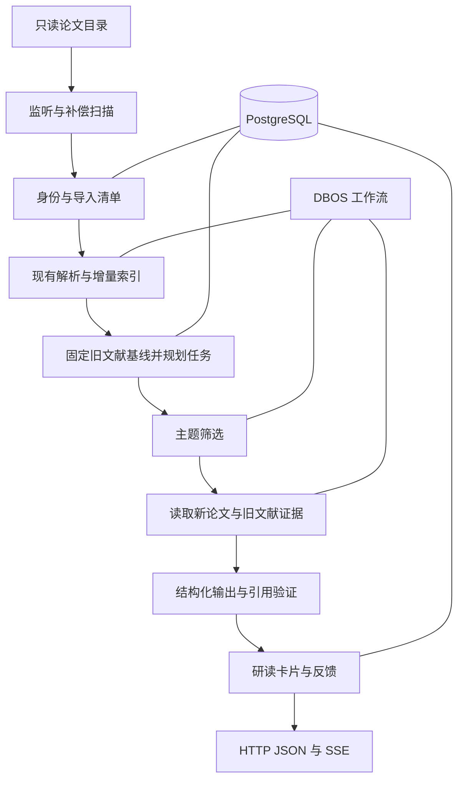

# 增量论文研读收件箱实施方案

## 需求与交付边界

用户将一批 PDF 放入已配置的论文目录，系统识别新增、重复和潜在版本关系，按用户研究主题筛选，然后生成带证据的阅读卡片。卡片回答三个问题：为什么值得读、与已收录论文有什么联系、先看哪里。

“新”表示新进入资料库，不表示最近发表。“相对增量”仅相对于明确列出的库内比较文献，不表示学术界首次提出。“已收录”不等于用户已读。

### 用户操作

1. 注册一个现有本地论文库，显示根目录和现有配置引用。
2. 完成基线登记；仅创建清单和必要索引，不启动存量模型研读。
3. 创建研究主题，例如“跨会话 Agent 记忆的存储、检索与评测”，填写关注维度和排除条件。
4. 复制新论文到目录，或主动请求一次扫描；查看批次和逐文件处理状态。
5. 在收件箱查看“优先读、可选读、暂缓、待核实”，打开引文及原始 PDF。
6. 标记“有用、不相关、稍后读、已读”，或为某篇未入选论文单独请求研读。

创建新主题默认只参与后续导入，不自动追溯全库。用户明确选择历史资产后，通过补研读接口执行；首次 seed 和每个新主题都避免隐式启动大量模型任务。

### 首版包含

- 单用户、一个本地库、嵌套目录 PDF、最多 5 个活动主题。
- 初始容量目标：1,000 篇存量、每批最多 50 个文件。超限显示待处理并分批，不丢弃。
- 监听、启动扫描、定期补偿扫描及手动扫描。
- 确定性文件去重，基于明确标识的论文关联，不确定身份的人工确认入口。
- 主题筛选、结构化研读卡片、最多 3 篇旧论文的比较、原文证据。
- 后台任务、重试、取消、阶段恢复、HTTP API、SSE 和反馈。

容量、并发和筛选数量是第一版工程限额，需要在当前 4 CPU、8 GiB 开发容器上测量后调整，不作为性能承诺。

### 首版不包含

联网搜索或自动下载论文、Zotero 云账号接入、跨库/跨用户搜索、自动移动/删除原始文件、完整论文管理前端、知识图谱、综述自动改写、通知到外部邮箱、MCP Tasks 协议升级。

扫描版 PDF 可以沿用现有 OCR，但效果不足时显示解析限制。没有可靠页码时使用章节、引文和正文位置定位，不生成 PDF 页码。

## 产品输出

每张卡片对应一篇 PDF 版本与一个主题，而非整个批次的泛化总结。

| 字段 | 契约 |
|---|---|
| 论文信息 | 标题、作者、年份、DOI/arXiv（可为空）、原文件位置；不确定元数据单独标注 |
| 主题相关性 | 高、中、低、待核实，附匹配维度与理由；没有校准前不展示伪精确概率 |
| 阅读优先级 | 优先、可选、暂缓、待核实；理由必须关联用户主题 |
| 核心内容 | 问题、方法、实验设置、发现、局限，未找到的字段写“未核实” |
| 比较 | 补充、扩展、冲突、实验不可直接比较、证据不足；每条列出实际比较论文 |
| 阅读入口 | 建议阅读章节及依据；链接到本地论文和证据 |
| 覆盖说明 | 基线论文总数、实际候选数、实际比较数、筛选上限及解析/检索失败 |
| 运行信息 | 主题版本、批次、模型、提示版本、耗时、实际报告的 token 用量 |

“冲突”需要核对任务、数据集、指标、预算等条件。证据不足时只写待核实，不以摘要中的不同数字断言论文互相推翻。

## 架构与模块

| 模块 | 输入与输出 | 职责边界 |
|---|---|---|
| Discovery | 文件事件/扫描 → 已登记路径与待处理批次 | 读取目录，判断就绪，恢复漏事件；不调用模型 |
| Catalog | 稳定 PDF → 文件哈希、论文身份、路径关联 | 元数据、去重、版本关系；不自动删除或合并原文件 |
| Index Adapter | 批次 → 成功就绪资产或逐文件失败 | 复用解析/嵌入/索引；不维护第二套正文解析器 |
| Topic Planner | 就绪论文、主题版本、冻结基线 → 研读任务 | 限额、显式入选与未入选状态、确定性任务身份 |
| Research Worker | 任务 → 有证据的卡片 | 受限 Pi profile，筛选、证据读取、比较和验证 |
| Inbox Service | 卡片、反馈、运行事件 → 查询结果 | 不依赖模型原始文本来推断成功或状态 |
| HTTP Host | JSON 请求/SSE → 上述服务 | localhost 单用户边界、幂等、验证、取消与关闭 |

MVP 可将模块放在同一个服务进程，另运行 PostgreSQL；模块划分不是拆成七个微服务。API 与 Worker 将来可独立进程化，但首版单实例完成协调。

## 技术栈与选型理由

| 技术 | 决策与理由 | 不引入的复杂度 |
|---|---|---|
| TypeScript 与 Node.js 24+ | 与当前库和容器保持一致，直接调用现有程序化 API | 不为后端重写为 Python/Java；Bun 继续用于仓库开发命令 |
| Fastify | schema 校验、输出序列化和可测试路由适合 JSON 服务 | 不搭建额外 BFF、GraphQL 或完整 NestJS 分层 |
| 现有 TypeBox | 研究输出与路由使用代码定义的 JSON Schema | 不让用户上传可执行 schema；需验证现有 TypeBox 与路由的兼容性 |
| PostgreSQL | 事务、唯一约束、JSONB 和查询支持导入清单、卡片及任务关系 | 不迁移现有 LanceDB/SQLite 数据；不把原 PDF 搬入数据库 |
| DBOS TypeScript SDK | Postgres 支撑阶段结果、持久队列及恢复，匹配批量研读 | 不再并行引入 BullMQ、Redis 或自研完整调度器 |
| 现有 Pi profiles | 每个任务独立会话，复用现有模型和凭据解析 | 不迁移 LangGraph/Vercel AI SDK，不新增第二个 Agent 主框架 |
| LanceDB 与本地 MinSync 嵌入 | 复用当前工作区已在建设的本地检索路径 | 不更换嵌入模型、维度或远程默认值 |
| SSE | 单向的阶段进度和卡片完成事件足够 | 不增加 WebSocket；取消通过 HTTP 请求表达 |
| Docker Compose | 复现研究服务与 Postgres、卷、健康检查 | 不引入 Kubernetes 或改动现有容器的运行状态 |

拟新增运行时包为 `fastify`、`pg`、`@dbos-inc/dbos-sdk`。具体版本在实施关卡锁定稳定版本并验证许可证与 Node.js 兼容性；避免把历史文章中的版本当成当前可直接安装的版本。DBOS 自管 schema，应用 SQL 使用 `pg` 和有序迁移，不引入 ORM。

按仓库约束，真正增加运行时依赖前需取得确认；此次文档不会安装依赖。若 DBOS 验证不通过，应修改该决策并说明原因，不能悄悄加入另一套队列。

近期依据：Elicit 2026 年 9 月的 Library/Routines 将已有文献与持续研究结合；DBOS 9 月介绍了 TypeScript v5.0 和队列改进。这里采用的是活跃方向与适合项目的实现，不据此声称 DBOS 的普及率或本模块原创首发。

## 核心流程

### 首次登记与历史基线

首次启用以“登记已有资料”为默认，扫描目录、计算指纹并关联现有解析镜像。未索引文件只创建索引任务。记录首次完整清单为 seed 批次，不生成研读卡片。

基线登记时启用监听并缓冲事件；将首次枚举出的文件固定为 seed 清单。其后发现的路径进入下一批。完成后再全量枚举一次补齐。枚举没有操作系统级原子快照：扫描期间复制进来的文件如果进入 seed 清单，将在完成页明确列出，用户可选中后补研读，不能声称毫秒级准确还原导入时间。

### 日常发现与导入

1. 监听文件事件，按目录与扩展名过滤；忽略 `.part`、`.crdownload`、隐藏临时文件和 `.autorag` 状态目录。
2. 启动时及每 5 分钟扫描一次清单，补上停机、事件溢出或重命名遗漏。扫描频率是首版默认值。
3. 文件大小和修改时间连续两次观察稳定，间隔默认 2 秒，尝试读取；读取/解析前后复核，变化则退回等待。稳定只是信号，不是完整性证明。
4. 每库一个协调器将安静窗口内的候选合并成批次：默认 5 秒，最长等待 30 秒，每批最多 50 文件。更多候选明确排到下批。
5. 批次开始时，在库锁内冻结此前 `ready` 的资产集合及正文指纹，随后处理本批新资产。解析失败、未就绪或当前批次资产不进入旧文献基线。
6. 文件 SHA256 相同只新增位置关联；明确 DOI/arXiv 可关联同一论文，不同字节保留为不同资产版本；不确定则创建临时身份并提示核实。
7. 调用既有刷新路径，读取逐文件结果和镜像指纹确认成功。整次 refresh 返回了结果，并不表示每个 PDF 都成功。
8. 成功资产进入主题筛选；失败记录保留实际错误，允许显式重试。没有变化时不做模型工作。

同一路径原地被替换为不同字节时，登记新的资产版本；旧资产与旧卡片保留，原位置转向新资产。它是兼容边界，不是主场景。

### 主题筛选与证据研读

每个主题使用问题、关注维度与排除条件。首版不训练个性化排序模型，反馈只供用户整理和后续评测。

1. 从现有解析镜像提取标题、摘要等候选元数据；缺失时允许一次有界模型提取。DOI 必须来自可信元数据或论文题头，不能把参考文献 DOI 当成本篇身份。
2. 对本批就绪论文用主题语义/词项匹配取得候选，并用有界结构化筛选给出理由。每主题每批最多 10 篇自动深读，其余保留为 `not_selected` 或 `deferred`，可以手动追加；此上限会限制召回，界面必须可见。
3. 读取新论文的相关章节，最多 3 个检索问题；只在本批冻结基线中找最多 3 篇旧论文。候选先排除目标资产及同一 paper_id 的其他版本，再结合主题排除条件生成 allowlist。没有旧文献时输出单篇研读，不强行比较。
4. 同批其他新论文不作为“旧文献”；首版不做同批互评。论文另一版本也不能被描述成独立工作的证据。
5. 受限 profile 只能调用按资产/证据句柄读取的工具。候选选择、范围控制和最终验证由宿主执行，不由模型自行决定文件权限。
6. 用代码定义的 `submit_paper_note` 工具提交结构化结果。宿主校验主题版本、枚举值、候选身份、引用存在性、指纹和原文片段；最多一次纠错提交，仍失败则进入 `needs_review`。
7. 将卡片、引用、用量和完成事件在同一应用事务中提交。重试不产生第二张相同卡片。

最多使用 12 个证据片段、合计默认 12,000 输入 token 预算；预算不足需标明未覆盖内容，而不是声称通读全文。这些是拟定上限，后续依据真实模型上下文与论文样本调整。

### 阶段恢复与取消

工作流分为规划、筛选、证据选择与读取、结构化生成、保存。随机数、时间、数据库查询、文件读取和模型调用都放在 DBOS step 中；工作流仅传递可 JSON 序列化的 ID、指纹和有界结果，不传递 AgentSession、AbortSignal 或文件描述符。

已完成阶段结果可以重用；执行中断的 step 可能重跑。外部模型调用可能已计费但尚未保存，不能承诺只计费一次。保存采用幂等键与唯一约束。

取消先持久化 `cancel_requested`，向当前任务的 AbortController 发信号，再检查 DBOS 版本提供的取消行为。DBOS 控制工作流不等于底层请求已经中断：保存阶段再次检查取消标记，终态写入通过行锁决定胜者。取消成功后禁止迟到响应生成新卡片；已成功的任务返回现有成功状态。

API 客户端断线不取消任务。关闭服务时停止接收新工作、取消/等待自身活动请求，保存阶段后退出；不能操作其他会话启动的进程。

## 接口和最小交互

以下为拟新增的 HTTP 契约，不代表当前 CLI 已具备相应命令。API 前缀为 `/research/v1`。

| 方法与路径 | 行为 |
|---|---|
| `POST /libraries` | 注册配置中的本地根目录，返回库 ID，不修改既有 AutoRAG 配置 |
| `GET /libraries` | 列出已登记库及 seed/扫描状态 |
| `POST /libraries/:id/scans` | 请求 seed 或 incremental 扫描，返回 `202` 与批次/请求 ID；同一库活动扫描复用或排队 |
| `GET /batches/:id` | 文件总数、成功、重复、失败、延后及逐文件原因 |
| `POST /topics` | 创建研究问题和筛选条件 |
| `GET /topics` | 列出主题、revision 和是否活动 |
| `PATCH /topics/:id` | 更改主题生成新 revision；仅影响后续任务 |
| `GET /inbox` | 按主题、优先级、已读状态进行游标分页 |
| `GET /inbox/:id` | 卡片、覆盖说明、证据与版本信息 |
| `POST /inbox/:id/feedback` | 设置已读、稍后读、有用或不相关，覆盖当前用户同类反馈 |
| `GET /papers` | 按库/批次列出论文及资产、重复/版本/身份待确认状态 |
| `POST /papers/:id/analyses` | 请求体必须给出 `assetId`、`topicId`；核验资产归属后补研读，允许历史论文 |
| `GET /runs/:id` | 查询阶段、原始错误、尝试次数和结果 |
| `POST /runs/:id/cancel` | 请求协作取消，返回实际状态 |
| `POST /runs/:id/retry` | 显式创建下一次执行 generation，保留原失败记录 |
| `GET /runs/:id/events` | 按持久化序号输出 SSE，支持 `Last-Event-ID` |

创建/扫描/补研读/重试请求接受 `Idempotency-Key`。相同键不同规范化请求体返回 `409`；相同键同请求返回原资源。校验使用 `400`，找不到资源用 `404`，后端暂不可用用 `503`，异步失败体保留底层错误，不将路径或 stderr 替换成泛化句子。

主要请求体约束：

- 注册库：`name`、`rootPath`、`runtimeConfigRef`、`workspaceRef`，路径必须属于操作人员预配置的允许范围，拒绝重叠 workspace/论文根目录。
- 创建主题：`libraryId`、`title`、`question`、`focusDimensions`、`exclusions`；问题最多 4,000 字符，维度和排除条件分别最多 20 项、每项 300 字符。
- 扫描：`mode=seed|incremental`；seed 仅对未完成初始化库有效。显式文件路径导入不属于首版 API。
- 补研读：`assetId`、`topicId`；宿主冻结当前主题和基线后返回 `202 { runId, state, eventsUrl }`。相同分析身份已有结果时返回已有资源；强制重做通过 retry 的新 generation 表达。
- 反馈：`kind`、`value`、可选 `comment`；评论最多 2,000 字符。身份冲突确认使用 `PATCH /papers/:id` 的显式 `identityResolution` 请求，只允许确认元数据或关联，不执行 PDF 合并/删除，所有受影响身份必须复核。

上述元数据更正不改写已有研读。拟增加 `PATCH /papers/:id` 时必须验证新 DOI/arXiv 唯一性；跨既有 paper 的复杂合并首版拒绝并提示保留两者。手动关联只允许将 provisional 资产归到一个明确既有作品，事务内更新关系，不替换文件。

首版仅绑定容器 loopback。若发布到主机，由操作人员明确选择仅主机 loopback 的端口映射，并使用随机服务 token 的环境变量引用；不能默认向局域网开放。实际部署配置在实施阶段另行创建。文件读取必须校验注册根目录、realpath、当前资产哈希；HTTP 不接受任意文件路径读取或执行命令。

SSE 只发送阶段、计数、卡片 ID 和诊断，不发送全部模型 token。持久事件默认保留 7 天，每运行最多 1,000 条，超过只合并进度事件，不丢终态；慢客户端超过 256 KiB 缓冲则关闭连接，客户端从最后序号续接。过期游标返回 `410` 并提示读取运行快照。

## 现有代码复用和必须新增的接入点

以下代码锚点以当前 `codex/observable-local-index` 工作区为准，部分为未提交改动，实施前必须在选定分支重新核实。相对链接在容器 `/workspace` 与宿主 bind mount 中均可使用。

| 现有文件 | 复用方式 | 当前限制和拟新增内容 |
|---|---|---|
| [src/automation/daemon.ts](../../src/automation/daemon.ts) | 复用 `@parcel/watcher` 后端及事件合并经验 | 原 pending Map 在内存，不是导入台账；不要把每个事件直接接到模型自动化规则 |
| [src/agent/watch-refresh.ts](../../src/agent/watch-refresh.ts) | 复用 debounce、背压和 stop 生命周期模式 | 不同时启动两套独立 refresh 监听器；研究服务统一协调刷新 |
| [src/core.ts](../../src/core.ts) | `createAutoRAGLite`、`refresh`、`searchSelected` 提供模型无关索引/检索入口 | 构造会加载既有记忆；研究实例显式使用独立 home/config/memory 引用，不碰真实用户全局状态 |
| [src/mirror/sync.ts](../../src/mirror/sync.ts) 与 [index-store.ts](../../src/mirror/index-store.ts) | `syncParsedMirrors`、`ParsedMirrorEntry`、source/output 指纹与失败记录 | 逐文件就绪需要宿主对账；不能仅看聚合计数 |
| [src/indexing/pipeline.ts](../../src/indexing/pipeline.ts) 与 [journal.ts](../../src/indexing/journal.ts) | 现有增量切块、向量复用、原子替换和恢复 | 维持原索引 writer lease；DBOS 的数据库锁不能代替 LanceDB 写入互斥 |
| [src/indexing/method.ts](../../src/indexing/method.ts)、[types.ts](../../src/indexing/types.ts)、[lance-store.ts](../../src/indexing/lance-store.ts) | 复用本地 hybrid 与 BM25 降级、source scope | 必须新增类型化 `sourceIds` allowlist，在 top-k 前过滤；空集合必须返回空，不能放宽成全库 |
| [src/retrieval/types.ts](../../src/retrieval/types.ts) | 沿用取消、诊断和检索结果结构 | 现有泛型 `filters` 不代表索引层已实现任意资产过滤；需贯穿新参数 |
| [src/filesystem/content-fingerprint.ts](../../src/filesystem/content-fingerprint.ts) | `fileSha256` 做稳定读取及字节指纹 | 它不是论文语义身份识别，不替代 DOI/版本建模 |
| [src/indexing/evidence-reader.ts](../../src/indexing/evidence-reader.ts) | 哈希验证、镜像读取与 `verifyEvidenceRevision` | 需要研究模块的句柄适配与授权回调；不存在可直接假定的全文研读公共 API |
| [src/agent/evidence-ledger.ts](../../src/agent/evidence-ledger.ts)、[read-local-evidence-tool.ts](../../src/agent/read-local-evidence-tool.ts) | 借用证据 ID、原文读取及校验约定 | ledger 属于会话；卡片必须保存独立的稳定指纹、引文和源定位，不能只存 `e1` |
| [src/profiles/agent-factory.ts](../../src/profiles/agent-factory.ts) 与 [session-model.ts](../../src/profiles/session-model.ts) | `createProfileSession`、现有模型/凭据解析，创建专用只读 profile | 每任务独立会话，提供受限 customTools；不直接复用可全库搜索的通用 toolkit |
| [src/observability/run-log.ts](../../src/observability/run-log.ts) | 沿用 token、延迟和错误的记录口径 | 新增研究 run ID 与阶段事件；不能将 best-effort 日志作为任务状态真相 |
| [src/dupey/filter.ts](../../src/dupey/filter.ts) | 参考既有重复排除和 keeper 选择规则 | dupey canonical-text hash 与 PDF 字节 SHA256 不同，不混作同一身份；不要求新增 dupey 守护进程 |
| [src/mcp/server.ts](../../src/mcp/server.ts) | 后续暴露研究任务时参考现有 tool schema | 首版不改 MCP 协议，不假定所有客户端支持 Tasks |

首版旧文献筛选必须在数据库 top-k 之前限制为被冻结的 source IDs。全库取 top-k 后排除新论文可能导致旧文献不足，不能当作正确实现。宿主从资产映射生成 allowlist，模型不能修改。该参数只针对支持它的本地检索方法，其他方法遇到该约束应明确不支持，不能静默忽略。

不建议将每篇研读直接交给 `AutoRAGAgent.searchDocuments()`：当前实例有活动会话、忙碌检查和通用工具面。研究 profile 更容易严格限制新论文/旧文献范围，并避免污染交互式对话记忆。

## 部署和数据位置

现有开发环境的 `/documents` 是 fixtures 的只读挂载，不等于用户真实论文目录。实施时需显式配置只读论文目录并选择独立可写研究 workspace；此次不新增或修改挂载。

拟定独立 Compose 服务模式使用一个研究服务和一个 Postgres。研究 workspace 保存于专属持久卷，Postgres 使用另一个专属卷；PDF 只读挂载，凭据仍由现有 Pi/home 引用解析。服务部署应为同一论文保留稳定容器路径，换路径时需重新映射位置。

索引和解析副产物仍位于研究 workspace；DBOS 输入尽量只传 ID、指纹和结果引用，应用库只保留有界引文，不在工作流历史重复存整篇 PDF。用户配置是否允许模型读取论文片段必须沿用可信设置；公开论文也不自动等于获准发送给新远程提供商。

数据库设计见 [数据库设计.md](数据库设计.md)，实施顺序与测试见 [实施与验收.md](实施与验收.md)。

## 官方参考

- [Elicit Research Agent](https://support.elicit.com/en/articles/14756886-elicit-s-research-agent)：利用已保存论文与收藏集开展研究。
- [Elicit Routines 2026 年 9 月 30 日](https://elicit.com/blog/introducing-routines-research-that-keeps-working)：持续研究的产品方向。
- [DBOS TypeScript 仓库](https://github.com/dbos-inc/dbos-transact-ts)：Postgres 工作流与队列的部署形态。
- [DBOS Workflows](https://docs.dbos.dev/typescript/tutorials/workflow-tutorial)：step、序列化、幂等与恢复边界。
- [DBOS Queues](https://docs.dbos.dev/typescript/tutorials/queue-tutorial)：持久排队和并发控制。
- [Fastify Validation and Serialization](https://fastify.dev/docs/latest/Reference/Validation-and-Serialization/)：基于 schema 的路由契约。

上述文档支持能力和选型判断，不是本项目集成验证结果。
