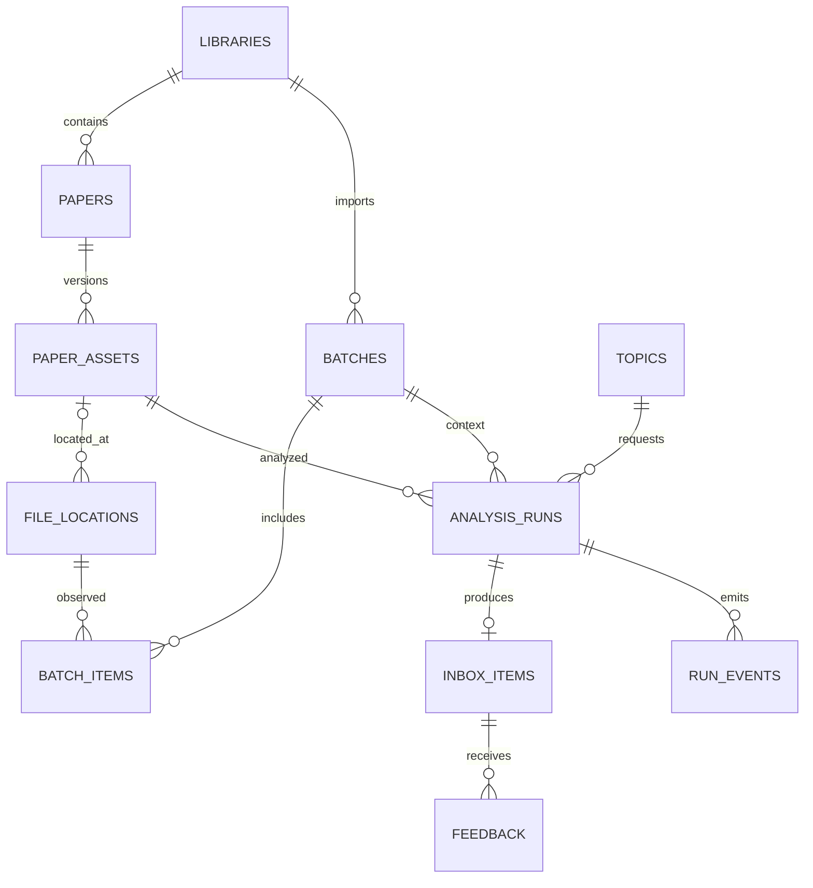

# 增量论文研读收件箱数据库设计

## 存储职责

PostgreSQL 的 `research` schema 保存业务元数据、运行投影与卡片；DBOS 使用自己管理的独立 schema 保存执行历史和队列，应用不能直接修改 DBOS 内部表。LanceDB 和现有解析镜像保存检索内容，原 PDF 留在用户目录。

数据库连接串、模型凭据、token 不写入下列表；只存配置引用和不含秘密的模型标识。应用使用 `pg` 参数化 SQL 和版本化迁移，所有时间使用 `timestamptz`，主键使用 UUID，状态使用 `text CHECK`。JSONB 的形状由宿主 schema 校验，不允许任意不受约束的模型 JSON 直接写入。

## 实体关系

论文是学术作品身份；资产是某份 PDF 的字节版本；位置是该版本目前的文件路径。一个资产可有多个位置，一个论文可有多个资产。路径被覆盖时改关联资产，历史研读仍绑定旧资产，不重写历史结论。

## 表结构

除特别标注外，业务字段非空；所有表均记录 `created_at`，可变记录另有 `updated_at`。下面的字段是实施契约，不是已执行的迁移。

### libraries

| 字段 | 类型 | 用途 |
|---|---|---|
| id | uuid PK | 库身份 |
| name | text | 显示名称 |
| root_path | text UNIQUE | realpath 后的论文目录；MVP 一个库 |
| workspace_ref | text | 独立研究 workspace 的配置引用 |
| runtime_config_ref | text | 可信 AutoRAG 配置的引用，不存其凭据 |
| state | text | `seeding / active / paused / error` |
| seed_manifest | jsonb nullable | 初始枚举路径及指纹/处理状态引用；完成后保留登记摘要 |
| last_successful_scan_at | timestamptz nullable | 上次完整成功扫描；不以它作为新增判断的唯一依据 |

扫描失败不更新成功时间。MVP 不做跨库相同文件去重。

### papers

| 字段 | 类型 | 用途 |
|---|---|---|
| id / library_id | uuid PK / FK | 学术作品与归属 |
| title | text nullable | 标题未知时界面回退文件名 |
| doi | text nullable | 规范化 DOI，去 URL 前缀和外围标点 |
| arxiv_id | text nullable | 不含版本后缀的作品标识 |
| identity_state | text | `provisional / identified / needs_review` |
| metadata | jsonb | 作者、年份、字段来源和核验状态 |

约束：`UNIQUE(library_id, doi) WHERE doi IS NOT NULL`；arXiv 同理。DOI 与 arXiv 若分别指向不同既有作品，进入 `needs_review`，不自动合并。来自参考文献区域的 DOI 不自动作为论文身份。只有同一明确标识才自动关联；标题相近不足以确认为同一篇。

### paper_assets

| 字段 | 类型 | 用途 |
|---|---|---|
| id / library_id / paper_id | uuid | PDF 版本及作品关联 |
| sha256 | char(64) | 稳定读取后的文件字节哈希 |
| size_bytes | bigint | 正整数 |
| first_batch_id | uuid FK | 首次登记该资产的批次 |
| version_label | text nullable | 如 arXiv v2；仅有依据时填写 |
| state | text | `identified / indexing / ready / failed / unavailable / needs_review` |
| source_id | text nullable | 当前可检索副本对应的现有 virtualPath |
| parser_profile | text nullable | parser/version/tokenizer/embedding profile 等非敏感身份摘要 |
| output_sha256 | char(64) nullable | 已解析正文指纹 |
| indexed_run_id | text nullable | 原索引运行 ID |
| metadata | jsonb | 标题/摘要等提取值、字段出处、缺失情况 |
| error_message | text nullable | 完整底层错误，可作长度上限但不按内容消除 |

约束：`UNIQUE(library_id, sha256)`；`sha256` 格式 CHECK；`size_bytes > 0`。`ready` 必须同时具备可授权读取的 source ID、源哈希、正文哈希和成功索引关联。重复字节可以通过已有就绪位置直接使用，不为另一位置重复嵌入。

同作品不同 PDF 字节保留不同资产。首版不做语义合并。既有 dupey 若因 canonical-text 相同排除了一个不同字节 PDF，需解析排除原因并关联可用版本或进入待核实；不能谎报该资产自身已索引成功。

### file_locations

| 字段 | 类型 | 用途 |
|---|---|---|
| id / library_id | uuid | 位置记录 |
| asset_id | uuid nullable | 完成哈希前可为空，完成后绑定当前字节版本 |
| path | text | 归一化、当前授权根目录下的绝对路径 |
| observed_size / observed_mtime_ns | bigint nullable | 就绪判断及低成本扫描提示，不代替内容哈希 |
| state | text | `waiting / hashing / present / missing / unreadable / failed` |
| last_seen_at | timestamptz | 最近确认存在时间 |
| error_message | text nullable | 读取/指纹失败原因 |

约束：`UNIQUE(library_id, path)`。数据库状态不是授权证明：读取时重新校验 realpath、搜索根目录及内容哈希，防止链接目标被替换。

移动文件表现为新位置出现、旧位置缺失，哈希相同则仍是一个资产。保留历史卡片中的旧路径，同时在展示时给出经核验的新位置。不修改 PDF 原文件。

### batches

| 字段 | 类型 | 用途 |
|---|---|---|
| id / library_id | uuid | 批次身份 |
| kind | text | `seed / incremental / manual_backfill` |
| status | text | `discovering / processing / completed / partial / failed / cancelled` |
| baseline_manifest | jsonb | 批次开始前 ready 资产清单，包含 asset ID、paper ID、source ID、源/正文 hash、profile |
| baseline_digest | char(64) | 按 asset ID 排序后对规范 JSON 计算哈希 |
| started_at / finished_at | timestamptz / nullable | 生命周期 |
| counts | jsonb | 显示用汇总；逐项记录为事实依据 |

首版每库最多一个活动导入协调批次，通过单实例协调与数据库 advisory lock 共同保证；不在完整 PDF 解析期间持有数据库事务。

MVP 基线最多 1,000 资产，JSONB 冻结清单可接受；超容量应拒绝或提示升级方案，不能截断清单后声称覆盖全库。扩容时可迁移为 snapshot/member 表，无需现在增加这一层。

### batch_items

| 字段 | 类型 | 用途 |
|---|---|---|
| id / batch_id / library_id / location_id | uuid | 批次观察到的路径 |
| asset_id | uuid nullable | 处理成功后对应资产 |
| observed_sha256 | char(64) nullable | 本次看到的字节版本 |
| kind | text | `unknown / new / duplicate / version / needs_review` |
| stage | text | `waiting / hashing / indexing / ready / failed / excluded / cancelled` |
| error_message | text nullable | 路径级原始错误 |

约束：`UNIQUE(batch_id, location_id)`。一个批次内同一资产多个路径可保留多行，但只能规划一次该资产的同主题研读。未完成读入时原地内容变化，重置该 item 的读取阶段并留下事件，不能将旧哈希配给新内容。

### topics

| 字段 | 类型 | 用途 |
|---|---|---|
| id / library_id | uuid | 主题身份 |
| title / question | text | 显示名与完整研究问题 |
| focus_dimensions / exclusions | jsonb | 有界字符串数组 |
| revision | integer | 从 1 开始，每次有效修改递增 |
| active | boolean | 是否参与下一批自动筛选 |

问题或条件变化时在事务内增加 revision。运行另存当时的完整主题快照，因此首版无需 topic_versions 表。删除使用停用，历史运行继续可访问。

### analysis_runs

| 字段 | 类型 | 用途 |
|---|---|---|
| id / library_id / batch_id / asset_id / topic_id | uuid | 分析目标与基线上下文 |
| topic_revision | integer | 当时主题版本 |
| topic_snapshot | jsonb | 问题、维度、排除条件的完整冻结值 |
| baseline_manifest / baseline_digest | jsonb / char(64) | 正常批次继承批次基线；手动补研读时排除自身与同作品版本 |
| target_revision | jsonb | 源/正文 hash、parser/index profile、元数据版本 |
| pipeline_version | text | 输出 schema、提示版本、筛选策略、模型 provider/id/settings 的非敏感摘要 |
| base_key | char(64) | 见下文幂等规则 |
| generation | integer | 显式重试代次，从 0 开始 |
| workflow_id | text UNIQUE | 由 run ID 确定性推导的 DBOS workflow ID |
| dispatch_state | text | `pending / submitted`；非独立任务队列 |
| state | text | `planned / screening / not_selected / deferred / reading / validating / succeeded / needs_review / failed / cancelled` |
| cancel_requested_at | timestamptz nullable | 持久化取消意图 |
| coverage | jsonb | 基线规模、候选/入选数、比较文献、查询和截断说明 |
| usage | jsonb | 模型报告的 token/cost 与阶段耗时，未报告为 null，不伪造 0 |
| error_message | text nullable | 最终或待核实错误 |
| last_event_seq | bigint | 从 0 开始，为本运行分配持久事件序号 |
| started_at / finished_at | timestamptz nullable | 生命周期 |

约束：`UNIQUE(base_key, generation)`。`generation > 0` 只由用户显式 retry 创建；自动 step 重试仍属于同一 run。`not_selected` 与 `deferred` 是可解释筛选结果，不是失败；手动请求对其深读时创建下一代执行，保留原筛选结果。

`base_key = SHA256(library_id, asset_id, target_revision, topic_id, topic_revision, baseline_digest, pipeline_version)`，按定义的字段顺序规范化编码。不同模型/提示/正文版本不会误复用旧结果。凭据不参与摘要，不进入数据库。

这里记录业务状态和筛选覆盖；DBOS 自己记录执行历史。应用通过 DBOS 公共 API 对账运行投影，不实现另一套 lease/worker 领取协议，也不直接 UPDATE DBOS 表。

### inbox_items

| 字段 | 类型 | 用途 |
|---|---|---|
| id / library_id / topic_id / asset_id | uuid | 卡片定位 |
| run_id | uuid FK UNIQUE | 一个成功运行至多一张卡片 |
| priority | text | `read_first / optional / defer / needs_review` |
| relevance | text | `high / medium / low / uncertain` |
| payload | jsonb | 问题、方法、实验、发现、局限、比较、阅读建议和覆盖说明 |
| evidence | jsonb | 有界引用数组，见下文 |
| review_state | text | `unread / later / read` |
| validity | text | `verified / source_unavailable / revision_changed / partial` |

成功卡片不可原地改写内容；重新分析生成新 run/card。查询默认按同主题/资产最新成功代次展示，旧卡片保留。用户阅读状态可在新卡片产生后显式继承或保持未读，首版保持未读。

每条 evidence 至少包含稳定的 evidence_ref、asset/paper ID、source ID、原始路径快照、源 hash、正文 hash、chunk ID、章节、UTF-16 起止位置、引文和支持的卡片字段。引文总量受 MVP 预算限制，schema 限长。

`e1` 只在一次模型会话内有意义，不能作为跨任务引用主键。PDF 页码缺失时保留为空；当前 UTF-16 Markdown 偏移不能冒充 PDF 页码。展示引用时若源版本改变，保留当时引文并提示当前不可重核验，不偷偷指向新正文。

### feedback

| 字段 | 类型 | 用途 |
|---|---|---|
| id / item_id | uuid | 反馈身份与卡片 |
| kind | text | `usefulness / relevance / reading_state` |
| value | text | 由 kind 对应的枚举校验 |
| comment | text nullable | 有界备注 |

约束：单用户 `UNIQUE(item_id, kind)`，更新覆盖同类反馈，reading_state 与卡片字段同事务修改。首版不训练反馈模型、不推断用户已读其他论文。

### run_events

| 字段 | 类型 | 用途 |
|---|---|---|
| run_id | uuid FK | 运行 |
| seq | bigint | 运行内严格递增，联合 PK `(run_id, seq)` |
| type | text | 阶段、计数、诊断、终态 |
| payload | jsonb | 有界业务数据，不存全量模型 token |
| created_at | timestamptz | 事件时间 |

事件分配与业务更新在同一事务：锁 analysis_runs 行、增加 last_event_seq、插入事件后提交。不用独立全局 sequence 直接当 SSE 游标，避免序号先分配后提交引发越过未提交事件。

重连按 `run_id + seq` 查询，客户端可去重。不要宣称网络恰好投递一次。保留/压缩不删除必要终态，过期游标按接口契约处理。

### api_requests

| 字段 | 类型 | 用途 |
|---|---|---|
| key / route | text | 幂等请求联合 PK |
| request_digest | char(64) | 规范化请求体 hash |
| resource_type / resource_id | text / uuid | 成功创建的资源 |
| response_status / response_body | integer / jsonb | 可重复返回的非敏感响应 |
| expires_at | timestamptz | 默认 7 天；清理后不再承诺 HTTP 请求键去重 |

资源创建和请求键写入必须同事务。工作流实际入队可随后补偿，响应资源先以 planned 状态存在。过期请求键可能重新触发请求，但分析业务唯一键仍防止重复卡片。扫描请求若已有活动扫描，返回活动资源而不是并行扫同一库。

## 跨表一致性与索引

所有带 library_id 的关联用复合外键匹配归属：父表增加 `UNIQUE(library_id, id)`；例如资产到论文、位置到资产、运行到主题/资产/批次必须属于同库。MVP 只有一个库，也不允许 API 传入不一致身份。

主要索引：

- `file_locations(library_id, state, last_seen_at)` 用于扫描对账和错误列表。
- `paper_assets(library_id, state)` 与库内 SHA256 唯一索引用于就绪清单和去重。
- `batch_items(batch_id, stage)` 用于批次进度和重试定位。
- `analysis_runs(dispatch_state, created_at)` 仅对 pending 建部分索引，用于补发已登记任务。
- `analysis_runs(library_id, topic_id, created_at DESC, id DESC)` 用于运行列表。
- `inbox_items(library_id, topic_id, review_state, created_at DESC, id DESC)` 用于收件箱游标分页。
- `run_events(run_id, seq)` 主键支持重放。

只给实际查询建立索引，首版不给所有 JSONB 建 GIN。卡片分页游标为 `(created_at, id)`，不按 OFFSET 扫描不断增长的收件箱。

## 事务与故障窗口

### 导入登记

路径观察先持久化。哈希计算在事务外执行；写入时复查观测版本，以 `UNIQUE(library_id, sha256)` upsert 资产，再关联位置和批次项。崩溃后扫描可恢复 hashing/waiting 记录。文件前后不一致不进入 ready。

单库批次开始前冻结 ready 基线。协调器串行执行批次索引，不在扫描中途将本批新增混进基线。DBOS 控制执行顺序，库锁保证重启期间旧/新协调器不同时规划。失去锁的进程停止提交；索引仍依赖现有 writer lease。

### 业务登记与入队

先在业务事务内创建 analysis_runs 并写 `dispatch_state=pending`。事务提交后调用 DBOS 的 start/enqueue 公共 API，workflow ID 由 run ID 推导。成功后标记 submitted。

启动及周期对账扫描 pending：

1. 业务提交后未入队就崩溃：用同一 workflow ID 补发。
2. 入队成功后未更新 submitted 就崩溃：查询或重复 start 同一 ID，不创建第二个 workflow。
3. run 在补发前被取消：不入队，持久化 cancelled。

首次集成必须验证所锁定 DBOS 版本对重复 workflow ID 和已终止 workflow 的行为。不能假设同一个 Postgres 地址就让业务事务与 DBOS 入队自动原子化。

### 结果提交

锁 run 行，检查取消、主题快照、源/正文指纹及当前终态。通过后以 run_id 唯一约束插入卡片，更新 succeeded、用量和完成事件后一次提交。提交完成但 DBOS step 确认丢失时，再次运行读回同一卡片。

取消与成功竞争由该行锁串行决定；已经成功则返回成功，取消先提交则禁止迟到成功。模型响应无论如何不能绕过宿主保存入口。

### 基线冻结与内容有效性

baseline_manifest 冻结的是成员和版本，不是对 LanceDB 的历史事务快照。检索前限定成员，读取时校验哈希；若论文原文件或索引版本被替换，排除并记录 coverage 缺口，必要时 needs_review。不能用同一 source ID 的新正文冒充旧基线。

每个运行从基线派生检索 allowlist 时，还要排除目标 paper_id 的所有版本和主题排除项；基线清单保留原貌以便解释筛选。两个资产若实际为同一作品，不能作为两篇独立旧文献累计比较数量。

比较证据在读取阶段保存有界引文和指纹，阶段恢复前仍需校验输入版本。目标论文变动则停止原 run，生成新资产后显式或按下一批处理；不覆盖原结果。

## 迁移与保留

有序 SQL 迁移与应用 schema_migrations 记录独立于 DBOS 迁移。应用启动检查 schema 版本，不自动降级。首版升级采用停止自己的服务、备份业务数据库与研究卷、迁移、重启验证的方式，不承诺无停机滚动升级。

DBOS/模型输出历史、运行事件与卡片分别设保留策略。卡片及反馈默认保留，事件默认 7 天；DBOS 历史清理只能使用官方支持方式，并保证仍运行 workflow 的恢复数据不被清掉。任何清理只涉及研究服务自己的数据库与 workspace，不删除用户 PDF 或原生数据源数据。
