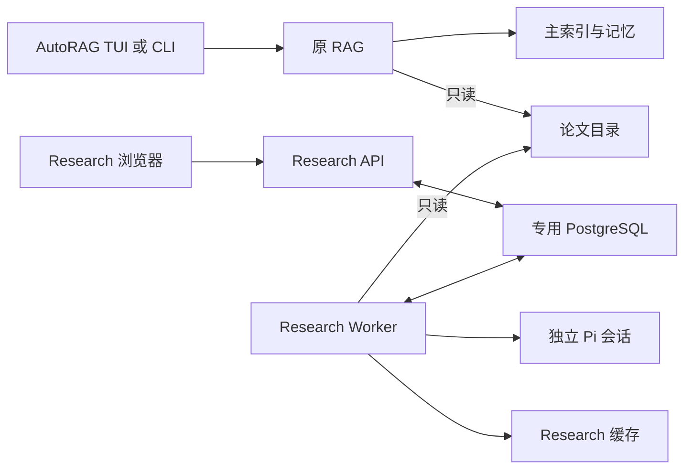

# 架构与隔离

## ADR-01 独立配套应用

新版 Research 不进入 AutoRAG 的运行请求链路。默认采用独立工程、独立依赖和镜像；与主系统只共享只读来源目录。旧代码清理单列任务，首轮不改主系统提示词、检索器、索引或 CLI/MCP 输出。

文档位置 `/workspace/myself_dev/1027_research` 不是应用源码位置。实施默认提案：宿主机兄弟工程 `/home/xsy/projects/AutoRAGResearch`，在专用 Research 容器内挂载为 `/research-app`。此路径尚未创建；实施时核实目标环境授权和挂载，不得在路径受限时擅自改为主系统 `src/` 下实现。

## 进程与调用关系



API 提供静态网页、JSON API、SSE 与受控 PDF 读取；Worker 执行文件观察、解析、模型请求及校验。API 不加载 Pi 运行时、不具备模型凭据，不做同步 PDF 解析。

数据库为独立实例和数据卷，业务 schema `research_v2`，DBOS schema `research_v2_dbos`。业务代码不直接操作 DBOS 表。迁移由专门入口执行，不能每次 API 启动都隐式迁移。

## ADR-02 独立工程内部模块

以下为建议布局，不表示当前已经存在：

```text
research-app/
  apps/web/                React 页面、矩阵、证据面板
  apps/api/                HTTP、SSE、静态页面和文件预览
  apps/worker/             派发、DBOS 流程、Pi 会话
  packages/contracts/     DTO、TypeBox schema、事件与协议版本
  packages/domain/        纯业务规则、版本和比较条件
  packages/storage/       PostgreSQL 仓储与事务
  packages/adapters/      PDF、文件系统、Pi、DBOS 适配
  migrations/             Research 专属迁移
  tests/                  契约、集成、浏览器和恢复测试
  deploy/                 镜像、Compose 与配置样例
  evidence/               运行证据，排除凭据与私人正文
```

依赖方向：web 只依赖 contracts 的浏览器安全类型；API 依赖 contracts、domain、storage 和任务客户端；Worker 依赖 domain、storage、adapters。contracts 不依赖数据库、Node 文件系统或模型 SDK；domain 不依赖 React、Fastify、Pi。

禁止跨工程 `../AutoRAG/src/*`、TS path alias、软链接或运行时动态导入主系统内部实现。源码迁用保留适用许可证，使用固定副本并由新版自己维护；不建立两个仓库之间的隐式同步。

## ADR-03 版本与技术栈

基线为 Node.js 24、Fastify 5、PostgreSQL 18、DBOS TypeScript SDK、Pi SDK、TypeBox；网页采用 React、TypeScript、Vite、TanStack Query，表格复杂时使用 TanStack Table，PDF 预览使用 PDF.js。Bun 只负责目标工程的依赖、脚本和构建，运行时保持 Node。

现有工程 Pi 1.2.0 和 DBOS 5.3.0 是兼容性验证候选，不要求直接升级。T-00 记录最终精确版本和锁文件摘要，测试通过后冻结。上游 main 文档不是已安装包的 API 保证。

不同时引入 LangGraph、Temporal、Redis 队列或 pi-durable。现有 DBOS 足以承担首版持久工作流；pi-durable 有重叠职责且官方标注实验性。

## ADR-04 无全库向量化前置条件

先按选中 asset 解析，按问题和维度选择章节与文本片段。MVP 不建立全库向量索引，不连接主系统 MinSync。选中论文集合较小时，直接章节读取加局部文本查找足以验证产品闭环；是否需要独立语义检索由评测决定。

不得因此把任意长度全文无预算地塞给模型。超限时拆分章节、减少范围，或明确报告覆盖不足。

## ADR-05 API、Worker 和持久派发

API 以一个事务写入业务 run、输入快照、请求幂等记录、初始事件和 `dispatch_state=pending`。Worker 获取有时限的派发租约，通过 DBOS SDK 以稳定 workflow ID 提交，再标记 submitted。它可重复派发，但不会创建不同的业务任务。不得在写业务记录前先触发远端模型。

这采用数据库待派发记录作为事务 outbox，不额外引入消息中间件。细节见 [数据模型](03-数据模型与状态机.md)。

派发去重与阶段成果去重分别处理：workflow ID 稳定只能避免重复任务身份；Worker 还必须用业务库 run_outputs 在成果、指针、快照和事件的同一事务中登记 output_key。DBOS 恢复点落后于业务提交时，重放返回原成果，不再次发布。API/Worker 共用这一业务契约，不通过额外队列解决。

## ADR-06 前端与状态

生产由 API 同源提供网页和 `/api/research/v1`；开发 Vite 代理到同一个 Research API。API 是状态查询入口，浏览器不直连 PostgreSQL 或 Worker。SSE 只推送已提交业务事件，刷新页面能够重取完整快照。

项目输入变更同步创建新矩阵快照；历史按 matrixVersion 投影。比较的 scope 和依赖有效性属于业务层，不能让前端凭当前值自行猜测。人工文本选区经 API 校验并登记证据，不启动 Worker 或模型；解析文本内容与证据身份仍由宿主控制。

不使用主系统 TUI 作为浏览器后端，不向网页转发完整模型思考或共享对话。Pi 事件先由 Worker 转换为业务阶段，再持久化和展示。

## 资源与故障边界

API、Worker、数据库分别设限，并记录合计预算。Worker 默认模型并发 1、解析并发 1；仅所选论文参与首轮任务，手动修复优先于批量分析。预算和硬上限参考 05、09，依据真实开发机容量调整。

独立容器不自动隔离共享 GPU、磁盘或提供商配额。若开启专属推理服务，要显式 endpoint、独立容量和健康检查，不能自动复用其他应用端口。未获得独立配额时，在报告中标明共享额度限制。

## 复用清单

| 现有参考 | 复用方式 | 必须调整 |
| --- | --- | --- |
| src/research/discovery.ts | 迁用稳定观察、指纹与路径校验 | 改为只处理显式选择，禁止全库自动消费预算 |
| database.ts、schema.ts | 参考事务、幂等和事件模式 | 新 schema、版本迁移、跨项目完整性与编辑并发 |
| worker.ts、service.ts | 参考阶段化与取消防护 | API/Worker 分离、派发租约、业务版本发布检查 |
| reader.ts、runtime.ts | 参考受限会话与结构化提交 | 去除主系统内部 import，增加领域工具与缺失值语义 |
| server.ts、client.ts | 参考 API 与 SSE | 新接口前缀、同源网页、ETag 与文件预览 |
| test/research/* | 迁用幂等、取消和恢复思路 | 新项目隔离夹具、旧接口不能直接算通过 |

## 架构验收

关闭 AutoRAG 后新版仍能完成一次 fixture 项目；关闭新版全部服务后 AutoRAG 独立启动。新版安装和构建不改主系统锁文件，数据卷不包含主系统状态。API 的执行依赖和镜像中不注入模型凭据。所有边界通过独立构建、挂载检查、故障测试和文件摘要验证。
