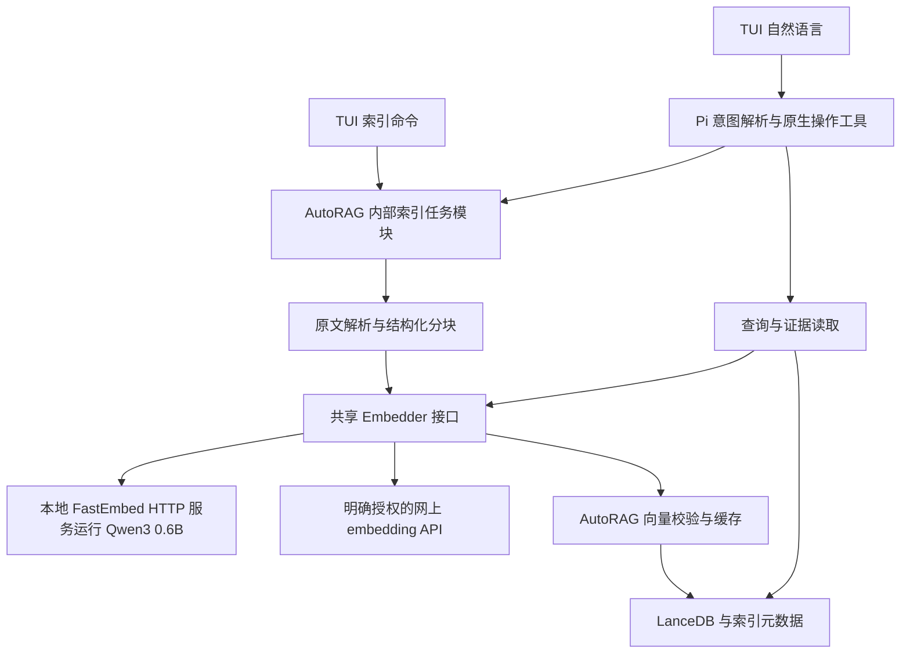

# AutoRAG 向量生成与索引分离架构

本地保留现有 `Qwen/Qwen3-Embedding-0.6B`，改由 FastEmbed 运行；网上 embedding API 仍可选，两者实现同一个向量生成接口。AutoRAG 保留所有索引责任，以此减少迁移范围，并把模型调用变成可观测、可替换的一层。

本阶段索引入口为 TUI 命令及自然语言操作，直接调用 AutoRAG 内部模块；不新增 MCP 功能。MCP 不参与本阶段的向量传输或新增任务控制链路，后续需要外部客户端接入时再独立扩展。

## 现有能力与待改内容

| 能力 | 当前工作区 | 本次目标 |
|---|---|---|
| HTTP embedding | 已支持 OpenAI 兼容协议与 TEI | 复用，补严格校验、重试和明确的本地/API 分类 |
| 本地 embedding 默认路径 | MinSync daemon 或可选 in-process addon，运行 Qwen3-Embedding-0.6B | 保留同一 Qwen 模型与 1024 维输出，改为 FastEmbed HTTP 服务 |
| 本地文档索引 | `LocalDocumentIndex`、LanceDB、缓存、journal、写锁 | 保留，补模型切换与任务封装 |
| 向量检索方法名称 | 仍使用 `minsync`，实现已落到本地索引 | 新增清晰名称，旧名仅作兼容 |
| 刷新事件与报告 | 已有阶段事件、计数和持久化状态 | 复用并增加任务控制接口 |
| MCP | 已有服务端 `autorag.refresh` 和 Pi 客户端 | 保留既有能力，必要兼容回归；新增索引工具与进度桥接延期 |
| TUI embedding 控制 | 面向 MinSync 进程 | 显式区分自管服务与外部服务 |

本阶段主要源码入口：`src/embedding/{embedder,http-embedder,managed,settings}.ts`、`src/indexing/{pipeline,method,lease,journal}.ts`、`src/agent/{agent,refresh-progress,embedding-controls}.ts`。`src/mcp/` 只属于既有能力的兼容核对范围，不是新功能实现入口。

## 目标调用链

箭头表示调用与数据处理关系。一次任务只选择其中一个 embedding profile，不能同时随机选择本地与 API。查询向量必须与所查索引匹配。

Pi 只在自然语言理解和问答路径使用对话模型；明确的 TUI 索引命令不依赖它。任务模块是 TypeScript 内部实现，不是新增的 MCP/HTTP 索引服务；现有 CLI 和程序接口复用共享索引逻辑并保持兼容。

## 模块责任

| 层 | 应负责 | 不应负责 |
|---|---|---|
| Python 服务 | 加载一个批准的模型、批量推理、token 限制、健康与模型元信息 | 扫描用户目录、解析 PDF、索引写入、操作用户文件 |
| TS embedding 适配 | HTTP、凭据引用、超时、取消、有限重试、响应验证、前缀规则 | 调用语言模型决定每个 chunk 如何嵌入 |
| 索引管线 | 解析、分块、增量识别、缓存、写入、来源映射、报告 | 修改原文、隐式更换模型 |
| 任务服务 | 任务快照、去重、单写者、状态、进度、取消 | 引入不必要的分布式调度 |
| TUI 命令与原生操作工具 | 收集受支持参数，调用内部任务模块，展示真实状态与错误 | 为不同输入复制索引算法或依赖 MCP |

## 为什么保持轻量

FastEmbed 基于 ONNX Runtime，可用 Python 调用且不要求安装 PyTorch；使用 FastEmbed 不要求部署 Qdrant 数据库。[FastEmbed 官方仓库](https://github.com/qdrant/fastembed)

首版 Python 服务建议使用 FastAPI 与 Uvicorn，单进程、单模型实例、一个有界推理入口。它们与 FastEmbed 的具体版本及传递依赖应锁定并经过供应链检查，不以未固定版本的安装命令作为交付物。

保留项目已有 LanceDB，不额外引入向量服务。任务状态写入工作区已有内部状态目录，不引入 Redis 或另一个守护进程队列。多个数据源共享同一向量服务，避免重复加载模型。

## 本地模型与硬件策略

首版本地默认模型确定为当前已使用的 `Qwen/Qwen3-Embedding-0.6B`，输出保持 1024 维，重点替换运行它的 MinSync，不同时更换模型。该模型面向多语言与跨语言检索，测试需覆盖中文、英文以及中文问题检索英文资料。[Qwen 官方说明](https://huggingface.co/Qwen/Qwen3-Embedding-0.6B)

FastEmbed 官方列出的 0.9.1 模型注册表已包含该 Qwen 模型；实施时锁定经过实测的 FastEmbed 版本和兼容 ONNX 制品，不默认切到带 `-Q` 的量化版本。现有 MinSync 缓存记录为 `safetensors`，是否可转换或需要下载同模型的 ONNX 文件需核验，不能承诺零下载或直接共享缓存。[FastEmbed 模型注册表说明](https://qdrant.tech/documentation/embeddings/fastembed/)

`BAAI/bge-small-zh-v1.5` 仅保留为后续可选优化。它主要面向中文，不作为当前中英文资料的默认模型；本轮迁移不下载、不预装、不切换到 BGE。是否引入它，应在 Qwen 迁移完成后按实际语言需求、速度和检索质量另行评估。

i7-10750H 先测试 CPU，分别记录容器 CPU/内存限制。GTX 1650 Ti 的驱动、容器 GPU 透传和 ONNX CUDA 兼容需单独验证；没有 GPU 也必须完成核心用例。GPU 是后续可选优化，不作为迁移成功条件。

保留 Qwen 意味着模型本身的计算量不会因为替换 MinSync 而消失。服务包装层保持轻量，模型资源占用以实测为准，不用小模型的性能假设评估本轮迁移。

## 服务启动与停止

首版开发部署建议沿用当前单容器开发方式，在容器内启动一个 FastEmbed 服务并监听 `127.0.0.1`。替换现有 MinSync 启动项属于后续实施范围，不能同时启动两者作为隐式回退。

非容器场景允许操作人员预先启动服务。若增加 AutoRAG 自管启动，须遵守以下契约：

- 健康检查和 `status` 只读，不下载模型、不安装依赖、不启动服务。
- `/embedding on` 或明确的索引启动操作可启动本应用拥有的服务；首次模型下载显示来源、缓存和进度。
- 以 PID、启动标识和端点验证归属，`off` 只能停止当前应用拥有的进程。外部服务显示“外部管理”，不代停。
- 搜索不能隐式安装模型、建索引或重新向量化。服务不可用时展示原始错误与启动指引。
- 本地服务运行后驻留复用；退出与重启规则与拥有它的进程一致，避免遗留无主服务。

Docker 若后续拆成同网络服务，需增加受信部署身份与访问控制；不能把任意内网 IP 都当成本地隐私边界。首版不默认监听公网地址。

## 数据边界

默认本地 embedding。远程 profile 必须在可信配置中开启远程发送，命令或自然语言只能选已授权 profile，不能凭提示词生成一个新 URL 并发送语料。

授权范围包括文档、检索问题、记忆、聊天 sidecar 和 Gist 等共享向量消费者。不同消费者按自身数据边界检查授权；切换默认 profile 不应悄悄扩大已授权数据源集合。远程对话模型的语料发送规则独立存在，本地 embedding 不代表全部问答流量都留在本机。

## 首版明确边界

本阶段不新增 MCP 工具、服务、客户端接入、协议进度或 Tasks 扩展；已有 MCP 能力维持原功能边界，必要时适配共享接口变化。后续如要支持外部客户端，只包装既有内部任务接口，不重新实现向量化和索引。

不做自动多提供方降级、不重写解析器、不把原生数据源迁入中央存储、不自动删除旧模型和旧索引。本次同模型换引擎先独立重建；后续更换模型也需要独立 profile。取消任务不等于撤销此前已提交的增量更新。
