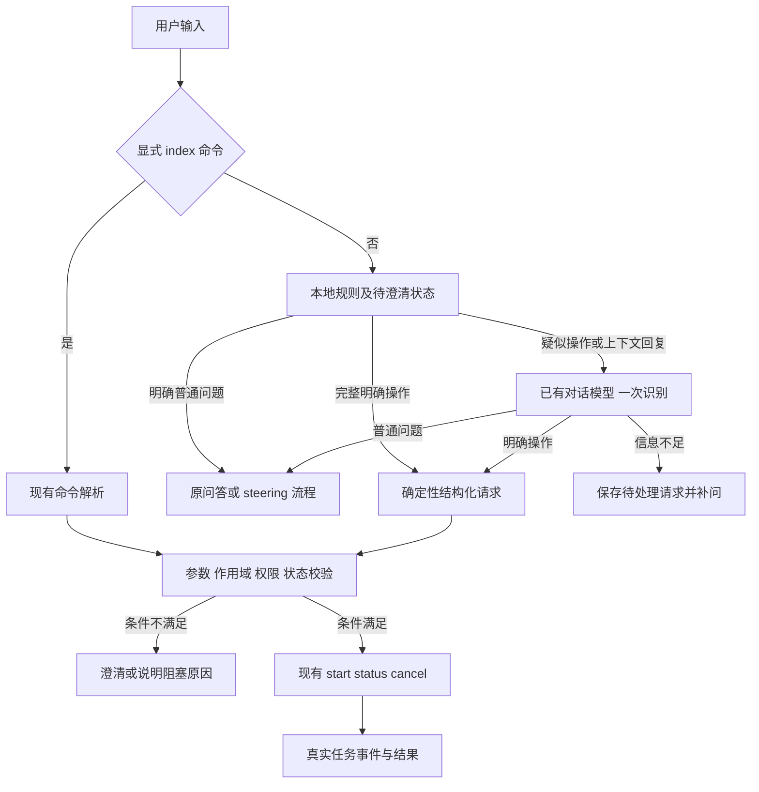

# 识别流程与接口

以下类型和函数名是实现建议，不是当前已有接口。优先用少量纯函数及会话内状态完成，不创建通用规则引擎。

## 1 分级识别流程



本地规则顺序：显式命令由现有注册机制处理；自然语言先检查待澄清上下文，再识别完整且无歧义的普通表达或操作表达，最后做候选召回。混合句、条件句、复杂否定和不完整表达进入候选，不能靠首个命中的动作词确定执行。

## 2 本地规则返回值

建议 `classifyIndexInput(text, pending)` 返回三种结果：

```ts
type GateDecision =
  | { kind: "ordinary"; ruleId: string }
  | { kind: "explicit"; request: IndexIntent; ruleId: string }
  | { kind: "candidate"; ruleId: string };
```

### 完整明确操作

规则必须消费完整有效输入，允许有限的礼貌前缀、空白和句末标点。例如：

- `[请/帮我] + [建立/建/创建/构建/重建/更新/刷新] + [当前索引/已配置文档目录的索引]`。
- `[查看/显示] + [当前索引状态/当前索引进度]`。
- `[取消/停止] + [当前会话的索引任务]`。

实际采用的句式以测试集为准；不要求第一版用规则支持所有模型名称、任意目录或自然语言组合。规则不能在删除否定、引号内容、从句之后，把剩余局部重新当成完整授权句。

例如“不要重建，只更新当前索引”不命中简单重建规则，应进入模型识别；“不要停止索引任务”也不等于取消。

### 明确普通表达

完整的概念咨询、教程请求、文档搜索或引用讨论可直接返回 ordinary。复杂表达不能因为含有“如何”或“解释”就一律排除，例如“解释完后重建”属于组合请求，首版需要拆分澄清。

### 候选召回

候选规则可宽于执行规则。结合动作和对象召回：索引、向量化、资料可检索、更新新文档、重新处理检索资料等；还包括与待澄清请求相关的参数回复。

只出现“新资料”不能视为明确操作；“总结新资料”应走普通问答。类似“让刚添加的资料也能搜到”应成为候选，但是否执行仍由完整语义和参数检查决定。

单独的“是”“用本地那个”只有在关联的待处理状态有效时才可补齐操作。没有待处理状态时，不得据此启动任务。

## 3 模型识别契约

候选路径调用当前对话模型，使用短提示词和结构化输出。该调用不提供 bash、索引写入或配置修改工具，不运行通用 Agent 循环。结构化输出通过现有 schema 能力校验；不新增依赖。

建议的逻辑结构：

```ts
type IndexIntent = {
  intent: "ensure_index" | "rebuild" | "refresh" | "status"
    | "cancel_job" | "abandon_request";
  profileRef?: string;
  scopeRef?: string;
  jobRef?: string;
  constraints: string[];
};

type ModelDecision =
  | { kind: "ordinary" }
  | { kind: "operation"; request: IndexIntent; evidence: string[] }
  | { kind: "clarify"; partial?: Partial<IndexIntent>; missing: string[] };
```

`profileRef/scopeRef/jobRef` 是用户表达或上下文引用，不是已经获得授权的执行参数。程序将其解析为已配置 ID。`evidence` 是用户请求中的简短依据，用于诊断；包含一句动作描述并不能独立证明用户要求执行。

模型输入只提供：当前用户输入、相关的待澄清摘要、可选 profile 的名称和类型、已配置范围的必要标识、当前会话相关任务标识。必要上下文应有长度上限。不要将检索正文、整段历史工具输出、认证内容送进分类提示词。

提示词要求：

1. 区分用户要求执行、询问方法、报告故障、禁止执行、引用他人指令。
2. 遵守否定和限制条件，不把“搜不到”直接解释成重建。
3. 参数未知就标记缺失，不创造目录、profile、任务 ID、URL 或授权。
4. 一次完成识别和参数提取，不输出执行代码。
5. 组合请求按首版边界返回 clarify，不能只执行其中一项。

不能将模型自行填写的 `confidence: 0.99` 当作校准概率或写操作许可。首版不依赖这一字段。

每条候选输入最多一次应用层语义识别；不自动追加第二个模型审查或格式修复请求。输出非法、超时或模型不可用时显示原因及 `/index` 指引，不启动写任务。底层传输重试若存在，另行记录实际请求次数和等待时间。

不规定虚构的延迟指标；按当前模型的实测设置超时与输出上限。必须支持取消，且超时后迟到的结果不能提交任务。

## 4 参数解析与执行许可

识别结果通过以下程序步骤转换为可执行请求：

1. 解析 scope：只接受全部已配置本地根。局部目录、未配置目录或外部数据源不能静默扩大范围。
2. 解析 profile：显式名称只匹配已有配置；别名唯一时解析，多义时澄清；限制为本地时排除 API。
3. 解析 job：优先使用当前请求明确指定、且属于可控制范围的任务；不得仅凭“最近”选择其他会话任务。
4. 对照用户限制：例如“不要重新向量化”与当前必须重建不兼容时，说明冲突并等待选择，不丢弃限制。
5. 根据真实索引状态产生执行计划；随后核验远程授权、任务所有权与并发条件。

建议将现有“操作类型集合”收紧为会话内的具体请求许可，绑定请求 ID、操作、解析后的 profile、scope、job 和会话版本。它不是持久凭据或通用授权服务。

已验证请求可直接调用内部任务，避免为了执行再调用一轮模型。如果继续保留 `manage_local_index` 工具路径，工具参数必须与该请求许可一致；不能把模型传入的 `authorized: true` 当作依据。status 不授予任何写权限。

提交成功后清除待提交许可，幂等性使用既有 requestId 和任务模块。失败、取消、切换话题、会话结束时同步清除或使版本失效。重复回调不能生成两个任务。

## 5 待澄清状态

首版每个 TUI 会话最多保存一项待处理请求，包括原始请求、已确定字段、缺失字段、请求版本，以及相关任务 ID。仅存会话内存，不建立长期任务数据库。

```text
idle → awaiting_details → validated → submitted → idle
                 ├─ 放弃请求 → idle
                 ├─ 切换话题 → idle，继续普通输入
                 └─ 参数修正 → awaiting_details 或 validated
```

- 回复恰好补足唯一缺失字段时直接继续，不重新询问所有参数。
- “取消”在待澄清上下文中默认表示放弃未提交请求；若同时可能指运行任务，追问对象。
- 断开或重启会话不恢复过期的自然语言许可；运行任务仍按现有任务模块展示真实状态。
- 普通新问题结束待处理请求；此后的“好的”不能复活旧操作。
- 不把澄清回复重复写入历史，不将它误作为正在执行的 RAG 搜索的 steering。

## 6 基于索引状态生成计划

| 意图与状态 | 计划 | 说明 |
| --- | --- | --- |
| ensure_index，无可用兼容索引 | build | 独立候选 generation |
| ensure_index，有兼容索引 | refresh | 检查变化，复用现有缓存 |
| rebuild | build | 保留明确重建意图，不擅自降级 |
| refresh，活动索引就绪且兼容 | refresh | 使用活动 profile |
| refresh，无就绪索引 | clarify | 询问是否转为首次建立，不扩大授权 |
| 显式切换到不同语义配置 | build | 说明需要重建与重新向量化 |
| status | status | 不启动模型服务或任何准备任务 |
| cancel_job | cancel | 回执区分受理与最终取消完成 |

自然语言未指定 profile 时，已有可用活动索引优先沿用其 profile；首次建立使用可信配置的默认 profile。显式要求本地时只能选择符合本地限制的配置。将最终 profile 明确传给任务入口，避免当前 `build` 默认 profile 与活动 profile 不同造成意外切换。显式 `/index` 命令保留原有默认规则。

执行前只读状态检查不启动服务、不下载模型、不写入索引。真正获得执行请求后才走现有服务准备流程。状态检查与提交间可能发生变化，应在现有写锁保护下重新核验活动代、配置指纹和范围；发生实质变化时停止或重新规划，不执行旧计划。

### 分块和向量化的判断

- 文档未变化且分块相关指纹一致：复用原结果。
- 文档变化：重新处理必要文档，按分块内容和兼容语义身份查找向量缓存。
- 模型、维度或语义指纹变化：不能混用旧向量，走候选重建。
- 分块规则或 tokenizer 变化：重新评估分块；可复用向量仍由实际兼容缓存决定。
- 候选 build 的当前实现不保证跨 generation 复用向量；本方案不额外引入跨代缓存。

现有 `pipeline.ts` 执行这些底层判断，模型不能指挥任意跳过分块或向量化步骤。ready 标记只说明索引就绪，不说明源文件没有变化。首版以 refresh 的扫描与报告确认无变化，不新建一个仅凭 ready 就返回 no-op 的捷径。

计划只说明“需执行、可复用、执行时确定”及原因；精确文档数、分块数、缓存命中和耗时以 IndexEvent/IndexReport 为准。不要在尚未扫描时展示虚构数量。
