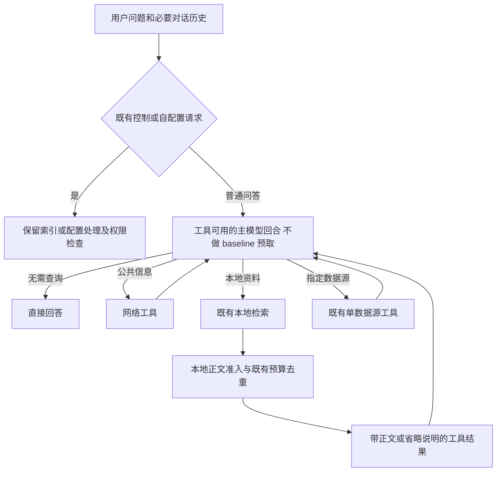

# 技术设计与契约

## 调用流程

以下为拟实现行为，配置及接口名称均是开发契约草案，不是当前版本已经支持的参数。

模型也可以在同一问题中先后使用网络、本地或指定数据源；不引入固定的单选分类结果来限制混合请求。保留既有工具调用上限、取消与错误处理，不增加无限的“查不到就重写再查”循环。

## 首问改造与 Jev 职责

`agent.ts` 当前首问同时承担查询规划、自配置、预取和分阶段回答。实施时在这些责任之间加模式分支，而不是整体跳过 `planQuery`：

1. 保留 `routeInteractiveInput` 的索引意图处理和已有 `/index` 控制流程。
2. 对 standalone 与 TUI 首问，现有 Jev 路由调用若原本启用，可继续用于识别 `config`，保留 `buildSelfConfigPrompt`、配置快照和失败回滚。此调用是已有开销，必须单独记账。
3. on-demand 模式中，非 config 决策不再触发查询分解、数据源预选或 baseline 预取。Jev 的 direct/local 结果不再决定是否强制禁用工具；普通请求统一进入工具可用的主模型回合。
4. Jev 不存在或失败时，跳过该辅助判断并保留诊断，直接进入普通 agent；不能保留旧的 local 预取回退。没有 Jev 时自配置能力仍受已有能力边界约束，不能顺带授予文件写权限。
5. 保留后续显式 `jev` 工具、引用相关性和证据记忆判断；本任务不把这些调用计为免费，也不承诺消除它们。
6. 后续 TUI 问题沿用现有普通回合，steering/follow-up 在原状态机处理。不要把内部生成的提示重新登记成真实用户请求。

首条普通提示应包含原始问题、回答和来源使用规则，不含空的 baseline 占位和“已经检索”指令。工具清单与顺序由已有配置确定，避免根据猜测的主题每轮反复改写 schema；工具范围限制仍由可信配置和现有权限机制执行。

single 模式直接产生完整答案。on-demand 与 progressive 组合在首版也执行一次工具可用的完整回答回合，不额外产生无证据快答或自动验证轮；preliminary 事件不保证产生，公共最终返回合同保持不变。这是有意的 opt-in 行为差异，必须写入后续配置文档并纳入 AC-16，不把它静默回退为 legacy 预取。

## 配置草案与回滚

建议增加两个独立的可信配置项，CLI 与程序化 API 使用同一套校验；不新增命令行调参面板。

| 拟新增字段 | 值 | 缺省 | 行为 |
| --- | --- | --- | --- |
| `retrievalPolicy` | `legacy` 或 `on-demand` | `legacy` | 是否保留普通首问预取 |
| `localEvidenceFilter.mode` | `off`、`observe`、`enforce` | `off` | 是否只记录或实际应用本地正文准入 |
| `localEvidenceFilter.calibrationPath` | 可信本地校准文件路径 | 无 | observe/enforce 所用校准合同 |

`contextSelection.mode` 和预算配置继续有效，职责仍为现有追加去重、候选选择与容量控制。新准入不应因为 `contextSelection` 未开启而悄悄失效：要么共用 projector 的基础生命周期并独立启用准入，要么以共享的请求转换步骤接入。T-03 冻结具体接线，并用 AC-09 证明组合行为。

observe 不改变正文，日志标记 `hypothetical: true`；enforce 才实际省略。缺少、损坏或不匹配的校准文件不得启动 enforce 并宣称过滤有效：启动时报可操作的配置错误。运行期间遇到不在该校准覆盖范围的候选按 unsupported 处理。

示例配置不写入日常 config。只有 T-06 验收通过才允许讨论默认切换；本规格不授权改变默认。回滚将两个新项恢复为 legacy/off，不删索引、语料和会话记录。模式或校准版本在已有会话改变时使请求视图失效并重建，记录原因，不能假装仍拥有原缓存前缀。

## 本地正文准入算法

### 输入和校准条件

输入来自结构化本地检索结果的 `localEvidence`，至少具有可信的 source/chunk 身份、正文指纹、当前 retrieval query、profile 和有效原始 cosine。同一文件名、eN、打印出的 score 不是充分条件。缺字段时不得从自然语言工具输出中猜测。

校准文件至少记录：schema/策略版本、embedding profile 指纹、评分定义（raw cosine）、语料和样本清单 hash、划分版本、适用语言与问题组、阈值、阈值选择目标、验证指标与审核记录。profile 指纹包括现有模型/维度等身份，不仅是可变的显示名称。

首版仅在经过校准的分组上启用硬拒绝。长问题、计数、全量总结、比较、多跳、跨语言和分解查询必须有对应分组证据才能宣称支持；否则记录 unsupported。问题组划分须确定、可测试，不新增 LLM 分类调用。禁止用一条“简单事实”正则推导所有复杂问题均已安全过滤。

### 处理顺序

1. 保留完整原始候选池和证据身份；按来源权限先执行既有范围检查。
2. 将候选按同一 retrieval query 和 profile 归组。工具 query 应解析当前追问指代；不得用上一轮 query 的 cosine 冒充本轮评分，也不比较不同组的绝对分数。
3. 在有效校准组中，以 `cosine >= minCosine` 标记 eligible，否则 rejected。阈值从冻结的校准文件读取，不在代码中写一个未经测量的通用常数。比较边界、NaN 和无穷值有明确测试。
4. unsupported 候选不做硬拒绝，交给已有展示与容量策略并计入 unsupported 指标；不能把它们当作已证明相关。缺失评分不等于低分。
5. 仅在 eligible 和 unsupported 池内执行原有分差、MMR、精确去重、rerank 顺序及预算处理。原 MMR/预算常数不替代新阈值。
6. rejected 自动候选不能被“至少展示一条”、重排失败或软预算例外重新加入。空 eligible 池是合法结果，不向非空池注入占位正文。
7. 最终模型工具结果保留调用配对，并用短说明表示“检索到 N 个候选，M 个正文通过准入；省略不代表未命中”。必要的引用句柄和来源元数据可保留，不能把正文复制进说明、details 转换或错误字符串绕过准入。

本流程只控制自动候选正文，不隐藏真实工具错误。retrieval error、rerank error 和 rejected 是不同状态。现有 `rerankPrefetchPool` 把非空池的空重排视为失败；新准入使用单独结果结构，不伪装成该空数组。先筛空后不调用 reranker；先重排后准入也不得因合法拒绝再次回退为未过滤候选。

### 结果语义

内部最小状态为 `eligible | rejected | unsupported`，每项附理由、策略/校准版本和证据身份。它是正文发送决策，不覆盖任何原始异常文本。

运行统计至少分开：`retrievedCandidates`、`eligibleCandidates`、`rejectedCandidates`、`unsupportedCandidates`、`finalVisibleLocalBodies`、`newLocalBodyTokensEstimated`。原始 API 的 resultCount 不改成可见正文数。不同来源的相同正文不合并来源身份；旧版本与新版本也不能共用读取锚点。

## 显式读取与误删恢复

复用现有 `read_local_evidence` 的版本定位、范围验证和恢复能力。它用于明确请求某条候选的原文，不是强制给每个普通问题加一轮读取。被省略的自动候选只有元数据句柄时不能称为“正文已核验”。

显式读取的正文不立即再次被同一相关性门槛隐藏；仍受源文件可读性、hash/profile、权限和容量保护。读取旧版本失败时原样报告，不能静默换成当前版本。普通 bash/read、网页和原生数据源结果首版不伪装成本地索引块过滤；它们的开销与越界情况必须分项报告。

## 记忆与多轮上下文

on-demand 禁止 `withMemoryContext` 在普通回合自动注入新的检索记忆正文，避免首问没有 baseline 却通过记忆重新引入语料。用户需要旧证据时由主模型显式调用 `check_memory`；其工具结果保持现有语义，首版没有可信 localEvidence 的记忆内容不套用本地 cosine 门槛。

保留用户和助手对话及已有证据前缀；模型需据此理解“这篇”“刚才那个”等指代。仅用当前问题一句话路由不能作为多轮实现。normal append 不重新评分、改写已提交正文或变更旧条目 score。

projector 的 prepare、dispatch、settle 与 reset 生命周期继续使用：

- 先构建新后缀准入视图，再执行去重、容量保护及 provider 输入限制。
- 原始 ledger 中有证据不代表 provider 上下文存在完整正文；被拒绝或裁掉的块不是锚点。
- 容量裁剪后检查短引用，无法恢复时明确省略；不能循环裁剪补回直至超限。
- 只有实际派发并成功消费的视图可提交；取消/失败不得污染下轮或另一会话。
- 模型、工具 schema、来源权限、分支、校准或准入模式变化时记录失效；权限优先。

历史无关正文删除需要打破前缀，首版不实施该功能。用户通过 `/new` 等已有新会话机制开始无历史上下文，必须实际清除客户端视图状态；这不承诺服务商删除其内部缓存。

## 观测与资源预算

在已有 run logger 增加准入事件，复用 pi-session 的实际 dispatch 观测。模型请求只记录受控测试所需内容；生产遥测优先记录身份/hash、长度、计数和错误，不另建全文语料快照库。

各模型调用按 `answer_session`、Jev、索引意图、查询分解、记忆判断、重试等 scope 计数。未知用量/价格用 null，不能填 0。本地 embedding、筛选耗时与服务等待独立计量。精确 token 仅以可用 tokenizer/provider 返回为准，估算量必须带 estimator 名称。

过滤确定性决策可按 query 身份＋证据版本＋策略/校准版本在当前会话复用；不新增跨用户持久缓存。未经评测不宣称降低 P95 延迟、总 token 或账单。具体对照与指标在验收文档定义。
