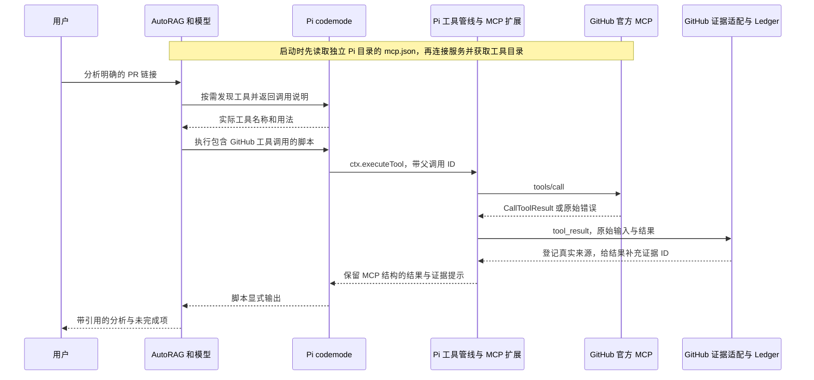

# 项目问题与变更分析助手技术设计

## 当前实现与复用位置

| 当前代码 | 已有能力 | 本方案的处理 |
| --- | --- | --- |
| [mcp-client.ts](../../src/agent/mcp-client.ts) | 读取用户级配置，`registerMcpServer`，加载 MCP、codemode、tool-search 扩展，补充服务简介 | 直接复用；不重写连接协议；无配置时仍不加载 |
| [pi-session.ts](../../src/agent/pi-session.ts) | 普通搜索及 TUI 的扩展装配、工具允许列表和会话生命周期 | 保留原接入；GitHub 证据扩展需同时覆盖两个会话入口 |
| [agent.ts](../../src/agent/agent.ts) | Agent 工具、会话装配、检索跟踪、最终答案推导 | 仅在必要位置装配 GitHub 证据适配，不增加全局规划循环 |
| [mcp-client.test.ts](../../test/agent/mcp-client.test.ts) | 临时配置、真实 echo MCP、预设模型、codemode 调用、失败与退出验证 | 沿用夹具与断言风格；它不证明真实模型自主选择 |
| [GitHub connector](../../src/datasource/skills/github/connector.ts) | REST 获取 Issue 与 PR 标题、正文并进入原检索管线 | 保留；不冒充实时 MCP 调用，不借本任务重做同步器 |
| [evidence-ledger.ts](../../src/agent/evidence-ledger.ts) | 对真实来源和片段生成稳定证据 ID，保存当前最多 2000 字符的片段 | 作为引用唯一登记入口，避免模型自行生成来源和 ID |
| [answer-citations.ts](../../src/agent/answer-citations.ts) | 从已登记证据生成编号引用、结构化结果和 mapping | 直接复用；未知引用继续报告诊断 |
| [evidence-persistence.ts](../../src/agent/evidence-persistence.ts) | 将 ledger 与编号保存到 Pi 会话，恢复分支状态 | 复用；不能只把证据存在新建的内存 Map 中 |

当前 MCP 客户端把外部工具接到 Pi，但没有专用 GitHub 结果到 EvidenceLedger 的适配。`recordSearchToolEvent()` 对现有搜索工具集合进行筛选，不能假设任意 `mcp__*` 结果已经自动进入检索跟踪或结构化引用。

本地安装的 Pi 1.4.0 已提供嵌套调用的 `parentToolCallId`、执行事件与 codemode 调用记录，应先复用。实现阶段重查依赖源码；不要修改 `node_modules` 或把其中实现复制为自研框架。

## 注册与调用架构

`searchTools()`、`describeTool()`、`describeNamespace()` 是 codemode 的本地工具发现能力，不是发给 GitHub 的业务 MCP 请求。发现与实际业务调用应分别记录。当前 Pi 实现的发现结果文本可以携带工具声明；不要仅因返回字段叫 `description` 就假设它只有一句简介。已经知道准确工具名和参数时，允许省略发现。

## GitHub 接入决策

首版选择官方远程 HTTP 服务，避免新增本地 MCP 可执行文件和运行时依赖。配置连接名为 `github`；远程端设置只读，并选择 `pull_request_read`、`issue_read`、`actions_list`、`actions_get`、`get_job_logs`。这些名称是当前官方资料中的接入候选，实施 P0 必须以真实 `tools/list` 与 schema 核对并冻结。

现有 Pi 支持 URL、headers 中的环境引用以及 `exposure`。示例配置只保留 `${GITHUB_MCP_TOKEN}` 引用。认证首选操作者提供的适当读取权限凭据；不自动复制日常 Pi 的 `auth.json`，不硬编码 token，不假定任意 GitHub OAuth 流程都与当前宿主兼容。

首版 PR 必须有明确仓库和编号。先读取 PR 身份与 head SHA；再查询变更与评论；只有存在关联 Issue、失败 run/job 时才继续相关读取。不采用固定必调清单，空评论、无关联 Issue、无 CI 都是可解释的正常结果。

## 最小新增实现

优先新增一个 GitHub 专用证据适配模块，例如 `src/agent/github-mcp-evidence.ts`，由 `agent.ts` 在两类 Pi 会话的扩展工厂中装配。它只处理连接名 `github` 的受支持只读工具，不处理其他 MCP，不产生网络请求，不改变其他工具结果。

业务指导放在一个窄范围 skill，例如 `skills/github-pr-analysis/SKILL.md`：何时使用、从 PR 身份到 CI 日志的依赖顺序、怎样保留证据提示、怎样报告不确定性。仅把 skill 放进仓库目录不等于 Pi 已加载；P1 必须验证实际会话的 skill 加载方式。对已安装技能的介绍遵守现有资源加载机制，不新增模型路由器。

跟踪首先使用 Pi 现有执行事件、codemode 的嵌套调用详情和会话记录。只有实测发现关键字段缺失才补充小范围应用层观察器；不新建追踪后端、数据库或全局事件总线。

## GitHub 证据适配契约

### 输入与筛选

输入是 Pi `tool_result` 事件中的工具名、输入参数、内容、`details`、`structuredContent`、错误状态、调用和父调用 ID。先确认事件来自可信配置的 `github` 连接与受支持工具，再解析 GitHub 业务结果。不能仅靠结果文本中出现 `github.com` 判定来源。

按照当前 Pi 的 `convertMcpResult()`，事件的 `structuredContent` 是发给脚本的 MCP `CallToolResult`；其中自己的 `structuredContent` 才可能是 GitHub 业务对象。还要支持 JSON 编码的 text content 和纯文本 diff/log，不能假定所有结果都是同一种 JSON。

### 来源与片段

| 结果种类 | 来源规则 | 应登记的内容 |
| --- | --- | --- |
| PR 或 Issue 对象 | 优先使用响应中的真实浏览器 URL | 与结论相关的描述、状态和明确关联信息 |
| 评论或 review | 优先使用评论自己的 URL | 评论片段及其主体，不能把一条意见写成全体共识 |
| diff 或文件变更 | 实际响应 URL；缺少时可用已验证调用身份生成该 PR 的 `/files` 页面，并标明为派生定位 | 变更片段，保留文件与 head SHA 上下文 |
| CI run/job 与日志 | 响应 URL，或已从真实结果取得的 run/job 身份对应页面 | 失败步骤和关键原文；只有 job ID 且无法确认 run 时，不编造链接 |

证据登记调用现有 `ledger.register({ method, source, content, ... })`。`method` 使用真实 MCP 工具身份，例如 `mcp__github__pull_request_read`；`source` 是可访问的 GitHub URL，而不是伪造本地路径。内容按原有片段上限分段、择取；不可把截断后的片段当成已读完整 diff 或日志。

成功但空的结果不生成假证据；`isError`、不支持的形状或无法定位的结果不登记为成功证据，原结果和错误仍返回。无法支持引用的部分必须有可见诊断，不允许整个解析异常终止已成功的其他调用。

### 给脚本和模型返回什么

补充一个文本内容块，包含 ledger 实际生成的 `[eN]`、来源与片段提示；保留 GitHub 原始业务数据、`isError` 和原有细节。

关键约束：当前 Pi 的 `tool_result` 钩子若替换 `content` 却不返回 `structuredContent`，会丢弃结构化值；而 codemode 对声明了 outputSchema 的工具优先把结构化值交给脚本。适配必须同时维护外层显示内容与脚本可见的 `CallToolResult.content`，保留其余原始字段及原有嵌套业务 `structuredContent`，不能只给 TUI 加一行提示而让脚本拿不到证据 ID。

skill 要求脚本筛选、汇总时保留它使用的证据 ID 与来源；没有显式 `return`、`text()` 等输出的中间值不会自动进入模型上下文。模型使用这些 ID，继续由现有答案推导与会话持久化处理编号。不得开放“模型传入任意 URL 和摘要即登记证据”的通用工具。

### 解析与幂等

对每个实际工具调用只登记一次；同来源同片段的重复读取依靠现有 ledger 稳定 ID 去重。分页结果逐页处理，标记尚未读取的页。取消、会话切换或关闭后的迟到回调不向新会话登记证据。恢复会话后，已输出的引用必须仍能解析。

## 调用跟踪契约

跟踪是 QA 与调试的观察数据，不替换现有产品输出合同。每次业务调用至少保留：测试 run ID、session ID、toolCallId、parentToolCallId、真实工具名、业务参数、开始与结束时间、durationMs、结果状态、来源与证据 ID、原始错误。顶层 codemode 记录脚本文本和脚本输出；发现脚本与业务脚本分别标识。

不把连接成功当成调用成功，不把 `searchTools()` 当成一次 GitHub MCP 业务调用，也不把一个 codemode 计成它内部所有请求的总成本。不要只扫描普通顶层 transcript 的 toolResult，因为嵌套调用可能仅保存在父结果及其事件中。

不采集认证 headers、环境值、完整 auth 文件或私人 corpus。底层业务错误和 stderr 按仓库规则保留，不用固定错误枚举替代原始信息。状态字段只用于统计，原错误文本仍须可见。

## 故障与只读边界

- 无配置时复用现有不加载行为；有配置但认证失败时报告实际错误，不生成成功分析。
- MCP 协议错误、工具级 `isError`、解析不支持、没有证据要分别可观察。脚本不能只靠 Promise 是否 resolve 判断成功，必须处理 `CallToolResult.isError`。
- 并发使用 `Promise.allSettled()` 或等效的独立错误处理，避免一条失败吞掉其他结果；日志查询依赖已经核验的 SHA/run/job。
- 复用已有取消信号、单请求 timeout 和会话关闭，不增加全局任务时长、工具总数或固定模型轮数限制。
- 远程只读模式限制的是该 MCP 服务，不能宣称隔离了整个 Pi 的 bash 或其他服务。首版不实现外部系统写流程，也不改变现有权限政策。

## 设计依据

核对日期为 2026 年 11 月 2 日。远程服务会变化，P0 需要记录实际返回的版本、协商协议与工具目录摘要。

- [GitHub 官方 MCP 项目](https://github.com/github/github-mcp-server)：只读仓库、Issue、PR 与 CI 能力。
- [远程服务配置](https://github.com/github/github-mcp-server/blob/main/docs/remote-server.md)：官方 HTTP 地址和远程配置方式。
- [服务端配置指南](https://github.com/github/github-mcp-server/blob/main/docs/server-configuration.md)：选定工具及只读控制。
- 本地 Pi 参考：`@earendil-works/pi-coding-agent/dist/extensions/mcp/{index,runtime,tools}.js`、`extensions/codemode/{tool,execute}.js`、`core/extensions/types.d.ts`。当前版本为 1.4.0；这些是依赖实现，不是本方案新增的功能。
